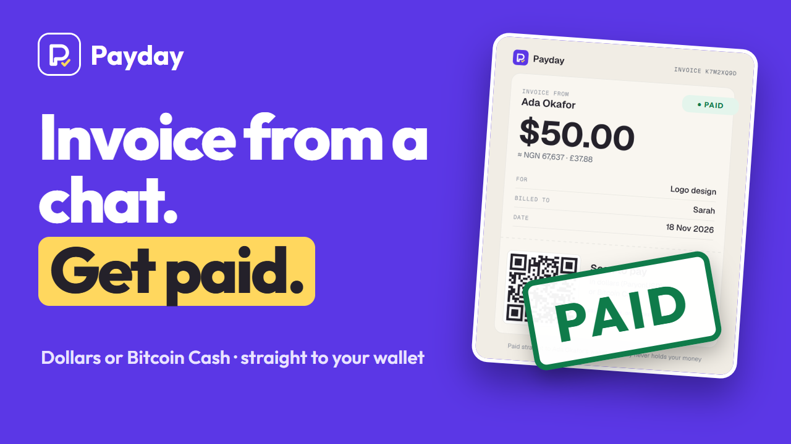

# Payday

**Send an invoice from a chat. Get paid in dollars on Bitcoin Cash.**

[](https://youtu.be/atdXMCbQMbo)

**[▶ Watch the 1-minute demo](https://youtu.be/atdXMCbQMbo)** · **[Try a 5¢ mainnet payment](https://payday-gumx.onrender.com/try)** · **[Open the Telegram bot](https://t.me/PaydayInvoiceBot)** · [Website](https://payday-gumx.onrender.com) · [Slides](https://payday-gumx.onrender.com/slides)

Payday is a Telegram bot + web pay page for freelancers. You type
`invoice Sarah $50 logo design` in Telegram, get an invoice and a pay link, and send it to your client on WhatsApp, Telegram, email or anywhere.
Your client opens the link, connects their wallet, and pays in **ParyonUSD** (a BCH dollar stablecoin) or **BCH**,
straight into your own wallet. The bot tells you the moment you're paid.

Built for [BCH BLAZE 2026](https://dorahacks.io/hackathon/bchblaze2026/detail).

## Why
Freelancers who work with clients in other countries usually depend on a bank or payment company in the middle to get paid. That can bring fees, limits or delays.
Payday makes an invoice as easy as sending a chat message, and the money goes straight from the client's wallet to the freelancer's.
It's **non-custodial**: Payday never holds anyone's money.

## Features
- Telegram bot: create invoices in one line or by answering 3 questions, priced in $, £ or ₦
- One "Send to client" button: share by WhatsApp, Telegram or email
- Invoice and receipt as a PDF
- `/invoices`: see who has paid and what you're still owed, with one-tap polite reminders
- Pay page: clean, mobile-first, pay in ParyonUSD or BCH via WizardConnect (tested with Paytaca, Selene and Cashonize)
- Any other Bitcoin Cash wallet can pay BCH with a plain QR code: each invoice gets its own exact amount, and Payday watches for it and marks the invoice paid (even if the client closes the page)
- Paid page: share the receipt as an image or a PDF
- Instant "✅ paid" notification in Telegram with blockchain proof
- Web invoice creator for people without Telegram

## Proof on mainnet
Real payments through the live pay page:
- ParyonUSD, scanned from a laptop: [249fc10e…](https://explorer.bch.ninja/tx/249fc10ef2da89f4ad294021476861d8c138bf4fd5776d00213d085ed009e8cd)
- BCH, scanned from a laptop: [82c60f9f…](https://explorer.bch.ninja/tx/82c60f9f81059728cdc15146c01fab2be84a9f2462dc573861776ac928e6a056)
- ParyonUSD, paid entirely on one phone: [9f0e9807…](https://explorer.selene.cash/tx/9f0e9807088394abbb05935fe154172e31d1c955a14391faacdc675fa2a3c544?network=mainnet)
- BCH, paid with Selene Wallet: [17025bd8…](https://explorer.bch.ninja/tx/17025bd81548818a789c87e33e6b593024168c5f01b5e7c70ad027d3b7d78abf)
- BCH, paid with Cashonize (web wallet, WizardConnect on the same laptop): [6ecfa540…](https://explorer.bch.ninja/tx/6ecfa540a1375ebad2ea4f1ff1dfd9ffd333fc75d5de93fcf4377b3ff5062962)
- BCH from a wallet's normal Scan (plain QR, no WizardConnect): [88cff117…](https://explorer.bch.ninja/tx/88cff117b3b0d344b87329ef9afae70699aac1d4241e8e563f84fa21ab941a63)

## Built during BCH BLAZE
Payday did not exist on 14 November 2026, so there is no earlier demo or code to compare with. The first commit is from 16 November: [`3842292`](https://github.com/Finney06/payday/tree/3842292e886f867331f94abb15a468409e2f5144). All the work in this repository was done during the hackathon.

## What if something goes wrong?

Payday is a direct payment, like a bank transfer: the client's wallet pays the freelancer's wallet.
Payday never holds the money, so most "what ifs" come down to that. Each answer below is what the code does today.

| What happens | What Payday does |
|---|---|
| **The client pays less than the invoice** | The server checks the signed payment before it is sent. If it pays the freelancer less than the invoice (ParyonUSD to the cent; BCH within 1% of the locked quote), it is refused and never broadcast. The client keeps their money. |
| **The payment isn't for this invoice** | Every Payday payment carries an `OP_RETURN` tag, `PAYDAY <invoice id>`. A transaction without the tag for *this* invoice is refused. |
| **The same payment is used twice, or the invoice is paid twice** | A transaction id can only mark one invoice paid, and a paid invoice refuses new payments. |
| **The BCH price moves while the client pays** | The BCH amount is locked for 20 minutes. ParyonUSD is a dollar stablecoin, so a $50 invoice is always 50.00 PUSD. |
| **The client's wallet doesn't have enough** | The pay page checks the balance first. If there's enough of the other currency (BCH or PUSD), it offers to switch. If the wallet is empty, it says so, and nothing is sent. |
| **The client cancels in their wallet** | "Payment cancelled in the wallet. Nothing was sent." They can try again. |
| **The network rejects the transaction** | The invoice stays Unpaid, the client sees the reason, and the money never left their wallet. |
| **The client pays from another phone** | An open pay page checks every 10 seconds and switches to the Paid receipt by itself. |
| **Payday's website or server goes down** | Money that was already paid is in the freelancer's own wallet, and each payment is public on the blockchain with its `PAYDAY` tag. Nobody needs Payday to get their money out. |
| **The freelancer loses their phone** | The money is in their own wallet (for example Paytaca), recovered with their 12 words. Payday has no keys and no balance. |
| **The client wants a refund** | Blockchain payments can't be reversed by anyone, Payday included. The freelancer refunds from their own wallet, as with cash or a bank transfer. |
| **The work isn't delivered** | Payday doesn't hold money in the middle (no escrow), so it's the same trust as an ordinary invoice. Escrow with a fair way to settle disputes is on the roadmap, not in this version. |

**Honest limits**
- The client needs a WizardConnect wallet (Paytaca, Selene, Cashonize…), or any BCH wallet for a plain BCH payment by QR, with BCH or ParyonUSD. Paying by card or bank isn't supported.
- If the server stops in the second between broadcasting a payment and saving it, the money still arrives, but the invoice can show Unpaid. The transaction (with its `PAYDAY` tag) on the explorer is the proof.
- Paytaca shows a payment in its balance once it confirms, so the bot may say "paid" a few minutes before the wallet balance changes.

## Run locally
```bash
npm install
cp .env.example .env   # add your BOT_TOKEN from @BotFather
npm start
```
Requires Node.js 22+ (uses the built-in `node:sqlite`).

## Testing
- `npm test`: tests for reading invoice messages, the bot's buttons, building payments (ParyonUSD and BCH), wallet-short errors, and the server refusing underpayments and payments for another invoice.
- `scripts/e2e-pay.mjs`: an **end-to-end payment** against a running server. It acts as the client's wallet through the same HTTP API as the pay page. It creates an invoice, reads the wallet's coins, gets the locked quote, builds the payment with `shared/tx.js`, signs it, and checks it with the Bitcoin Cash VM. Then it confirms that Payday refuses an underpayment, accepts and broadcasts the real payment, marks the invoice Paid, and refuses the same payment twice.
  ```bash
  # in one terminal: a separate chipnet server with the bot off
  BOT_TOKEN= NETWORK=chipnet PORT=3200 DB_PATH=./data/chipnet-e2e.db node src/index.js
  # in another: fund the payer address it prints (chipnet.bch.ninja faucet), then
  node scripts/e2e-pay.mjs --base http://localhost:3200 --network chipnet --usd 0.01
  ```
  Passed on chipnet on 17 Nov 2026: [58de43d3…7402b42](https://explorer.selene.cash/tx/58de43d320e881c1b43566bd26a22bb8c9e2e8a57f059356a9668798d7402b42?network=chipnet).

## Tech
Node.js, [grammY](https://grammy.dev) (Telegram), Express, PostgreSQL (SQLite locally), [Libauth](https://libauth.org),
[WizardConnect](https://gitlab.com/riftenlabs/lib/wizardconnect) for wallet connection. The WizardConnect logo on the pay page comes from that project (LGPL-3.0-or-later).

## License
MIT
